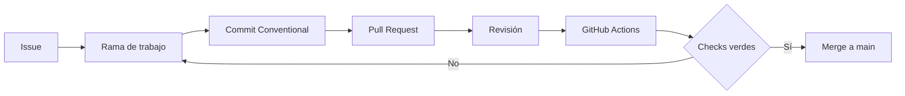

# Flujo de trabajo de TaskFlow

## Estrategia de ramas

TaskFlow usa un flujo ligero basado en GitHub Flow con una rama `main` estable.
Cada cambio funcional o documental se trabaja en una rama corta asociada a un
Issue. Esta estrategia evita ramas de integración permanentes, mantiene los
cambios aislados y permite que CI valide cada Pull Request antes de integrarlo.

Las ramas usadas para las entregas iniciales fueron:

- `docs/specs-sdd`
- `feature/backend-base`
- `feature/frontend-base`
- `chore/gitignore-update`
- `ci/github-actions`
- `feature/backend-filtros`

## Ciclo de cambio

1. Crear o seleccionar un Issue.
2. Crear una rama descriptiva desde `main`.
3. Implementar el cambio con pruebas.
4. Abrir un Pull Request asociado al Issue.
5. Obtener una revisión aprobatoria.
6. Ejecutar el pipeline de GitHub Actions.
7. Integrar el Pull Request en `main`.
8. Eliminar la rama únicamente después de la integración, según la política
   del repositorio.

## Commits

Los commits siguen Conventional Commits. Los tipos usados por el proyecto
incluyen:

- `feat`: funcionalidad nueva.
- `fix`: corrección.
- `docs`: documentación.
- `test`: pruebas.
- `ci`: automatización.
- `chore`: mantenimiento.

Los mensajes deben ser breves, descriptivos y estar escritos en inglés,
siguiendo la convención del repositorio.

## Issues, milestones y Project Kanban

Cada cambio se asocia a un Issue. El repositorio organiza el trabajo en
milestones por hito:

- Hito 1: Configuración y especificaciones.
- Hito 2: Backend y base de datos.
- Hito 3: Frontend Angular.
- Hito 4: CI/CD y documentación.

El proyecto GitHub **TaskFlow Kanban** agrupa los Issues y usa los estados
`Todo`, `In Progress` y `Done`. Los Issues de configuración y especificaciones
se colocaron en `In Progress`; los Issues de backend, frontend y CI en `Todo`
al configurar el tablero.

## GitHub Actions

El workflow [ci.yml](../.github/workflows/ci.yml) se ejecuta en `push` y
`pull_request` hacia `main`, con dos jobs:

- `backend`: `npm ci`, `npm run build` y `npm test` dentro de `backend/`.
- `frontend`: `npm ci`, `npm run build` y `npm test` dentro de `frontend/`.

Ambos jobs usan Node.js 20 y caché de npm basada en su `package-lock.json`.
Las pruebas del frontend usan el runner Vitest de Angular en modo
`--watch=false`.

## Spec Kit y GitHub Copilot

El desarrollo siguió la estructura de Spec Kit visible en el repositorio:

1. `constitution`: se creó
   [constitution.md](../.specify/memory/constitution.md) con principios
   obligatorios de calidad, pruebas, arquitectura, UX, flujo, automatización y
   documentación.
2. `specify`: se creó
   [spec.md](../specs/001-taskflow-task-manager/spec.md) con contexto,
   historias, requisitos y alcance.
3. `clarify`: las decisiones confirmadas sobre nombres, fechas, búsqueda,
   ordenamiento, confirmaciones, rendimiento e historial están reflejadas en
   `spec.md`.
4. `plan`: se creó
   [plan.md](../specs/001-taskflow-task-manager/plan.md) con stack,
   arquitectura, modelo de datos, API, frontend y pruebas.
5. `tasks`: se creó y organizó
   [tasks.md](../specs/001-taskflow-task-manager/tasks.md) por historias de
   usuario y paralelismo.
6. `analyze`: las correcciones de consistencia quedaron reflejadas en el plan
   y las tareas.
7. `implement`: las fases implementadas dejaron código y pruebas en
   `backend/` y `frontend/`.

GitHub Copilot se utilizó como asistente para explorar el repositorio,
implementar por fases, ejecutar pruebas y verificar el estado Git. Las
decisiones y la integración se mantuvieron bajo revisión humana mediante
Issues, Pull Requests y la política de revisión del proyecto.

No se afirma aquí que exista un archivo de registro de cada comando de Spec
Kit: el repositorio conserva los artefactos generados y sus resultados, no un
log completo de la conversación.

## Incidencias y correcciones durante la entrega

El trabajo no fue completamente lineal. Se detectó que la rama de filtros
partía de un `main` local desactualizado; se actualizó `main` mediante
`git pull --ff-only` y después se incorporó el cambio a la rama sin reescribir
historia. Durante la implementación de filtros, un parche parcial produjo un
error de sintaxis en las capas de repositorio y servicio; se corrigió antes de
continuar y la suite final quedó en 7 suites y 22 pruebas aprobadas.

También se corrigió la documentación para no afirmar que existían el endpoint
o la pantalla de historial, los reintentos automáticos ni la prueba de
rendimiento. Esas funcionalidades quedaron identificadas como trabajo futuro
en la especificación y en `tasks.md`.
